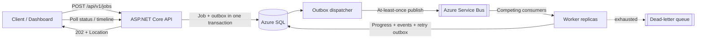

# NimbusFlow

NimbusFlow is an Azure-native workflow automation platform built to accept long-running work without tying up HTTP requests. The ASP.NET Core control plane persists every submission in Azure SQL, writes a queue command through a transactional outbox, and returns `202 Accepted`. Independently scalable workers consume Azure Service Bus messages, checkpoint progress, retry transient failures with exponential backoff, and dead-letter exhausted jobs.

The repository is intentionally production-shaped: clean boundaries, durable state transitions, idempotency, optimistic concurrency, observability, containerized local infrastructure, Bicep, automated tests, and an OIDC-based GitHub Actions deployment.

   

## Architecture



The API and workers never need to be online at the same time. Azure SQL is the system of record, Service Bus isolates backpressure, and every handler treats message delivery as at-least-once.

## What makes it production-grade

- **Non-blocking REST contract:** submission returns immediately with a durable job URL.
- **Transactional outbox:** a database commit cannot leave a job permanently stranded without its queue command.
- **Idempotent submission:** `Idempotency-Key` returns the original resource instead of creating duplicate work.
- **Idempotent consumption:** duplicate messages for terminal or currently running jobs are harmless.
- **Two retry layers:** application retries use scheduled Service Bus messages and exponential backoff; transport failures use Service Bus delivery counts and the DLQ.
- **State machine:** guarded transitions prevent invalid retries, cancellations, or duplicate completions.
- **Optimistic concurrency:** SQL `rowversion` protects competing updates.
- **Crash recovery leases:** abandoned `Running` jobs are reclaimed after a durable lease instead of becoming permanently stuck.
- **Audit timeline:** every meaningful transition is stored as an append-only job event.
- **Elastic workers:** the Bicep deployment scales worker replicas from 0–10 based on Service Bus backlog.
- **Managed identity:** Container Apps pull from ACR and access Service Bus without connection-string secrets.
- **Operational baseline:** structured correlation IDs, RFC 9457-style problem responses, health probes, rate limiting, OpenTelemetry traces and metrics.
- **Repeatable delivery:** locked NuGet dependencies, multi-stage non-root images, analyzer-enforced builds, tests, Bicep, and GitHub OIDC deployment.

## Local quick start

Prerequisites: Docker Desktop with Linux containers, Docker Compose, and the .NET 10 SDK if you want to run tests outside containers.

1. Copy `.env.example` to `.env`.
2. Read the linked [SQL Server](https://go.microsoft.com/fwlink/?LinkId=746388) and [Service Bus emulator](https://github.com/Azure/azure-service-bus-emulator-installer/blob/main/EMULATOR_EULA.txt) license terms. If you accept them, set `ACCEPT_EULA=Y` and replace the sample SQL password.
3. Start the complete platform:

   ```powershell
   docker compose up --build
   ```

4. Open [http://localhost:8080](http://localhost:8080). The dashboard can launch jobs, show live progress, demonstrate automatic recovery, cancel work, inspect timelines, and manually retry failed jobs.

The official Service Bus emulator is ephemeral by design. Azure SQL job data persists in the `sql-data` Docker volume, while queue state is recreated on emulator restart.

## API tour

| Method | Route | Purpose |
|---|---|---|
| `POST` | `/api/v1/jobs` | Submit durable asynchronous work |
| `GET` | `/api/v1/jobs` | Filter and page through jobs |
| `GET` | `/api/v1/jobs/{id}` | Read current progress, result, or error |
| `GET` | `/api/v1/jobs/{id}/events` | Read the execution timeline |
| `POST` | `/api/v1/jobs/{id}/retry` | Manually requeue a failed job |
| `POST` | `/api/v1/jobs/{id}/cancel` | Cancel queued/running work |
| `GET` | `/api/v1/jobs/stats` | Read dashboard aggregates |
| `GET` | `/api/v1/workflows` | Discover supported workflow types |
| `GET` | `/openapi/v1.json` | OpenAPI document |
| `GET` | `/health/live`, `/health/ready` | Container health probes |

Submit a job:

```bash
curl --request POST http://localhost:8080/api/v1/jobs \
  --header "Content-Type: application/json" \
  --header "Idempotency-Key: export-2026-08-30" \
  --data '{
    "workflowType": "data-export",
    "input": { "dataset": "customers", "format": "parquet", "recordCount": 24000 }
  }'
```

To watch automatic recovery, add `"simulateFailureAtStep": 2, "failForAttempts": 1` to `input`. The first attempt fails, the job is scheduled with exponential backoff, and the next attempt succeeds without blocking any API caller.

## Supported demo workflows

- `data-export` — validate, extract, transform, package.
- `document-processing` — ingest, extract, enrich, persist.
- `webhook-delivery` — validate, sign, dispatch, verify.

These deterministic step handlers make reliability behavior easy to demonstrate. Replace them with domain-specific implementations while preserving the job state machine and messaging envelope.

## Build and test

```powershell
dotnet tool restore
dotnet restore NimbusFlow.slnx --locked-mode
dotnet format NimbusFlow.slnx --no-restore --verify-no-changes
dotnet build NimbusFlow.slnx --configuration Release --no-restore
dotnet test NimbusFlow.slnx --configuration Release --no-build --collect:"XPlat Code Coverage"
```

The test suite covers domain transition invariants plus API submission, retrieval, idempotency, cancellation, discovery, and validation through an in-memory test host.

## Azure deployment

`infra/azure` provisions:

- Azure Container Registry
- Azure Container Apps environment, API, and autoscaling workers
- Azure Service Bus Standard namespace, duplicate-detecting queue, and DLQ
- Azure SQL serverless database
- Log Analytics
- Separate user-assigned identities with least-privilege ACR and Service Bus roles

The `Deploy to Azure` workflow first provisions shared infrastructure, builds immutable images tagged with the Git commit, pushes them to ACR, creates a new Container Apps revision, then verifies `/health/ready`.

Configure a GitHub `production` environment with:

- `AZURE_CLIENT_ID`, `AZURE_TENANT_ID`, `AZURE_SUBSCRIPTION_ID` for an Azure federated credential.
- `SQL_ADMIN_LOGIN` and `SQL_ADMIN_PASSWORD` as environment secrets.

Run **Deploy to Azure** from the Actions tab. Azure SQL and Service Bus are billable resources; review the Bicep SKUs and your Azure budget before deployment.

## Repository map

```text
src/
  NimbusFlow.Domain/          Job state machine and entities
  NimbusFlow.Application/     Use cases, contracts, ports, workflow catalog
  NimbusFlow.Infrastructure/  EF Core, Azure SQL, Service Bus, outbox
  NimbusFlow.Api/             REST API, dashboard, health, security middleware
  NimbusFlow.Worker/          Concurrent step execution and retry policy
tests/                        Unit and API integration tests
infra/local/                  Service Bus emulator configuration
infra/azure/                  Subscription, core, and Container Apps Bicep
.github/workflows/            CI and OIDC-based Azure deployment
docs/                         Architecture, decisions, and operations runbook
```

## Resume-ready talking points

- Designed an event-driven .NET platform that separates request latency from long-running execution with Azure Service Bus competing consumers.
- Implemented transactional outbox and idempotency patterns to provide reliable at-least-once processing across Azure SQL and Service Bus.
- Built configurable exponential retries, cooperative cancellation, dead-letter handling, audit timelines, optimistic concurrency, and KEDA-style backlog autoscaling.
- Automated analyzer-enforced builds, integration tests, code coverage, container image creation, Bicep provisioning, and immutable Azure Container Apps releases using GitHub Actions OIDC.

See [architecture details](docs/architecture.md), the [transactional outbox decision](docs/adr/001-transactional-outbox.md), and the [operations runbook](docs/runbook.md).
