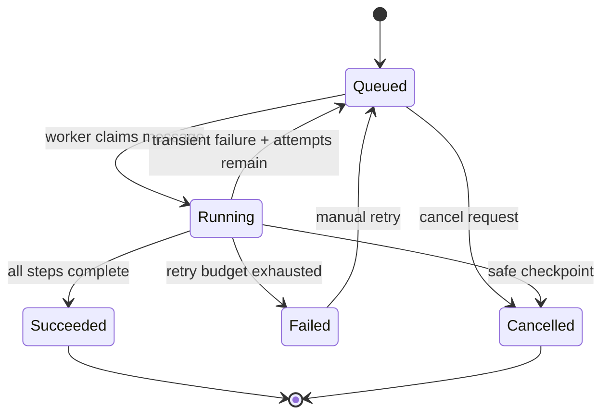

# Architecture and reliability model

## Request path

`POST /api/v1/jobs` performs only bounded work: request validation, workflow lookup, an Azure SQL transaction, and response serialization. The transaction inserts both the `WorkflowJob` and an `OutboxMessage`. The API returns `202 Accepted` with a resource location; it never waits for execution.

An outbox dispatcher polls unpublished rows and sends each command with the outbox id as its Service Bus `MessageId`. The Azure queue has duplicate detection enabled. Publication is intentionally at-least-once: a crash after send but before `ProcessedAt` can cause a second send, but cannot lose a command.

## Execution path

Workers use a Service Bus processor with manual settlement, concurrent consumers, prefetching, and automatic lock renewal. A handler loads the authoritative SQL job before doing work:

Terminal messages are completed as duplicates. Application failures schedule a new outbox command and complete the current delivery. Exhausted failures update SQL and dead-letter the message. Unexpected transport or infrastructure failures abandon the delivery, allowing Service Bus delivery-count handling to take over.

Each running attempt owns a renewable execution lease. If a worker disappears after checkpointing `Running`, a redelivery schedules a durable recovery check for the lease deadline. The check is harmless when the original attempt finishes; otherwise, it reclaims the abandoned job for another guarded attempt. This closes the classic "consumer crashed after claim" gap without permitting concurrent execution.

## Consistency guarantees

- Submission durability: SQL transaction.
- Queue delivery: at least once.
- Handler effect: idempotent by job state.
- Ordering: per job state transitions, not global queue ordering.
- Progress: checkpointed after each safe step.
- Manual retry: a new execution cycle on the same durable job id.
- Cancellation: immediate while queued, cooperative at step boundaries while running.

## Scale model

The API maintains at least one replica and scales on HTTP concurrency. The worker scales to zero and up to ten replicas from the `workflow-jobs` backlog. `MaxConcurrentCalls` adds concurrency inside each replica. Azure SQL is serverless and auto-pauses after inactivity; the first post-pause request can therefore have cold-start latency.

## Security boundaries

- A user-assigned API identity can pull the API image and send queue messages.
- A separate worker identity can pull its image, send retry commands, and receive queue messages.
- Service Bus local authentication is disabled in Azure.
- The SQL login is an encrypted Container Apps secret populated by the protected deployment environment.
- Optional `Security__ApiKey` enables constant-time API-key validation; production deployments should normally place Entra ID or API Management in front of the public ingress.
- Rate limiting, request size bounds, correlation ids, non-root containers, TLS-only Azure ingress, and dependency auditing provide baseline defense in depth.

## Evolution paths

The next production iterations would replace the SQL login with Entra-only database authentication, use private endpoints and a workload profile environment, move API authentication to Entra ID/APIM, and add a dedicated schema-migration job instead of startup migration. None requires changing the domain state machine or public job contract.
